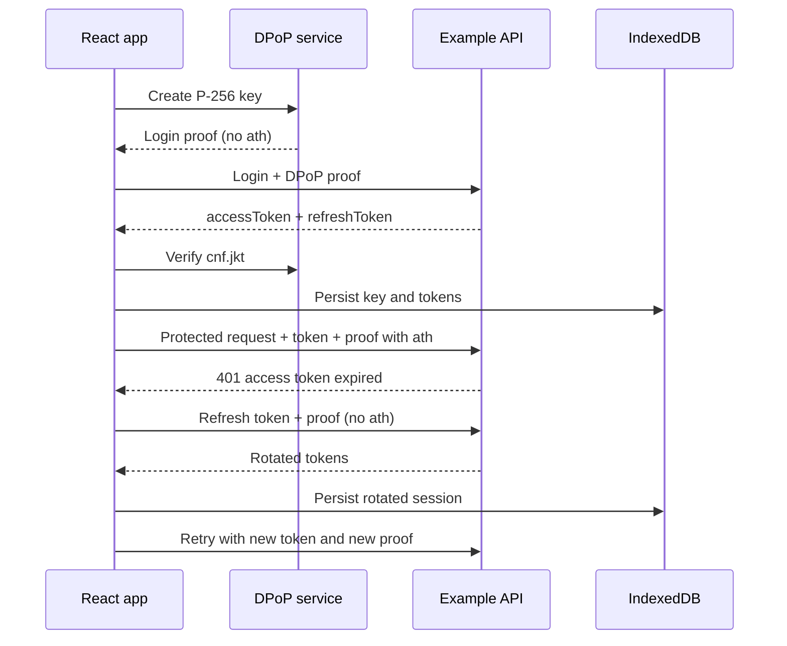

# DPoP React demo

A small React + Axios reference implementation for a typical authentication system that has an
`accessToken`, a `refreshToken`, and token refresh after the access token expires.

All URLs and payloads in this repository are generic examples. The default host is
`api.example.invalid`, a reserved domain that cannot accidentally call a real service.

Vietnamese documentation: [`docs/README.vi.md`](docs/README.vi.md).

## What the demo covers

- Generates a non-extractable ECDSA P-256 private key with the Web Crypto API.
- Creates an ES256 DPoP proof for login, refresh, and protected API requests.
- Validates that the JWT `cnf.jkt` claim matches the browser key.
- Saves the `CryptoKeyPair` and token session in IndexedDB so reloads can restore the binding.
- Adds `Authorization: DPoP <accessToken>` and a new `DPoP` proof to every protected request.
- Uses a single shared refresh promise when concurrent API calls return `401`.
- Persists rotated tokens, then retries the original request with a new proof.
- Clears the session when refresh fails.

## Run locally

```bash
nvm use
npm install
cp .env.example .env.local
npm run dev
```

DPoP depends on Web Crypto and therefore requires HTTPS or `localhost`.

## Configuration

```env
VITE_API_BASE_URL=https://api.example.invalid
VITE_LOGIN_PATH=/auth/dpop/sign-in
VITE_REFRESH_PATH=/auth/dpop/refresh
VITE_PROFILE_PATH=/api/me
```

The API may be on another origin, but that server must allow the application origin, the `DPoP`
and `Authorization` request headers, and the required HTTP methods through CORS.

## Example backend contract

### Login

```http
POST /auth/dpop/sign-in
DPoP: <proof without ath>
Content-Type: application/json

{"username":"demo.user","password":"..."}
```

```json
{
  "accessToken": "<JWT with exp and cnf.jkt claims>",
  "refreshToken": "<refresh token>"
}
```

The authorization server must calculate the RFC 7638 JWK thumbprint from the public JWK in the
proof header and return it as `cnf.jkt` in the access token.

### Protected resource

```http
GET /api/me
Authorization: DPoP <accessToken>
DPoP: <proof with ath>
```

The resource server should validate the proof signature, `typ`, `alg`, `jti`, `iat`, `htm`, `htu`,
and `ath`, then reject replayed `jti` values.

### Refresh

```http
POST /auth/dpop/refresh
DPoP: <proof without ath>
Content-Type: application/json

{"refreshToken":"..."}
```

The refresh response uses the same shape as login. The demo keeps the previous refresh token if
the server does not rotate it. The new access token must remain bound to the same DPoP key.

## Main flow



## Where to adapt

- `src/config.ts`: endpoint configuration.
- `src/auth/session.ts`: login/refresh request and response adapters.
- `src/security/DpopProofService.ts`: key generation, proof signing, binding validation, persistence.
- `src/api/client.ts`: Axios request/response interceptors and automatic retry.

## Security notes

- DPoP reduces replay risk for stolen access tokens; it does not prevent XSS. Keep a strong CSP and
  avoid untrusted script execution.
- This browser example stores refresh tokens in IndexedDB for clarity. For production systems,
  evaluate an `HttpOnly`, `Secure`, appropriately scoped cookie and CSRF protection according to
  your threat model.
- The frontend only decodes JWT claims for local flow control. Signature, issuer, audience, expiry,
  and DPoP binding validation remain mandatory on the backend.
- A new proof and `jti` are generated for every request. Do not cache or reuse proofs.
