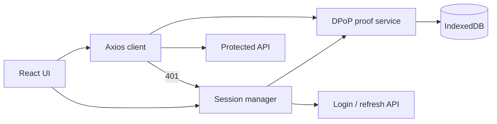
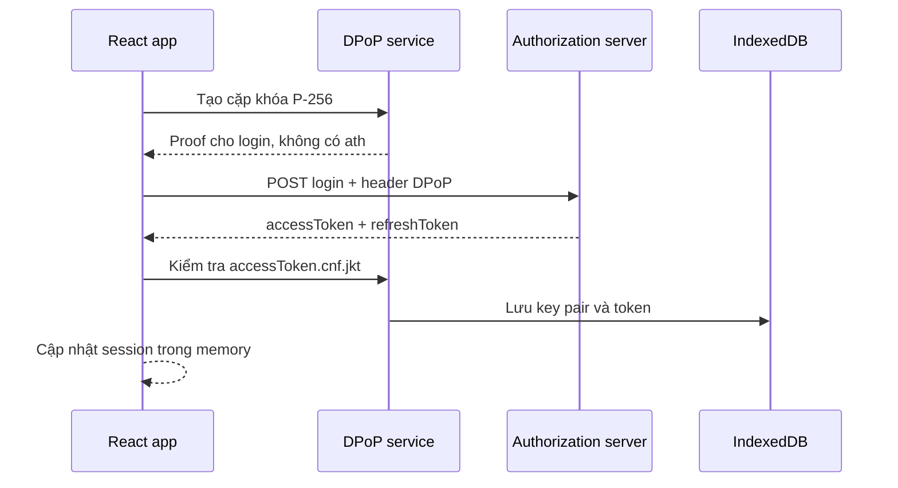
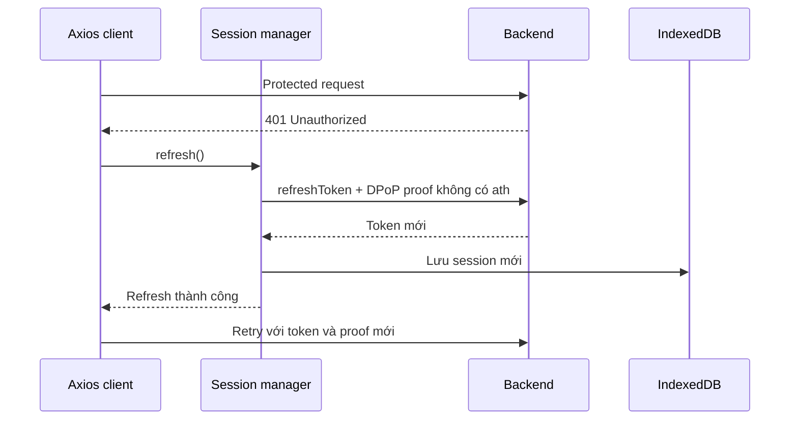

# DPoP React demo

Đây là project tham khảo cách triển khai DPoP (Demonstrating Proof of Possession) trên frontend
React sử dụng Axios và Web Crypto API.

Project tập trung vào flow xác thực phổ biến gồm `accessToken`, `refreshToken`, tự làm mới token khi
API trả `401` và gọi lại request ban đầu. Demo chỉ triển khai DPoP, không có nhánh Bearer fallback.

Các endpoint trong repository là dữ liệu mẫu. Domain mặc định `api.example.invalid` là domain dành
riêng cho tài liệu và không trỏ tới hệ thống thật.

## Tính năng

- Tạo cặp khóa ECDSA P-256 trong trình duyệt.
- Đặt private key ở chế độ non-extractable.
- Tạo ES256 DPoP proof riêng cho từng request.
- Kiểm tra access token có `cnf.jkt` khớp với public key.
- Lưu key pair và token session trong IndexedDB.
- Khôi phục session sau khi reload trang.
- Tự thêm `Authorization: DPoP <accessToken>` và header `DPoP` vào protected request.
- Chỉ gửi một refresh request khi nhiều API đồng thời trả `401`.
- Hỗ trợ refresh-token rotation.
- Retry request ban đầu bằng access token và proof mới.
- Xóa session nếu refresh thất bại hoặc request retry tiếp tục trả `401`.

## Kiến trúc

| Module | Vai trò |
| --- | --- |
| `src/security/DpopProofService.ts` | Quản lý key, tạo proof, kiểm tra token binding và IndexedDB |
| `src/auth/session.ts` | Login, restore, refresh, logout và session trong memory |
| `src/api/client.ts` | Axios interceptor cho protected request và xử lý `401` |
| `src/config.ts` | Endpoint lấy từ biến môi trường |
| `src/App.tsx` | Giao diện chạy thử flow |



## Flow đăng nhập



Authorization server cần lấy public JWK từ header của proof, tính JWK thumbprint theo RFC 7638 và
đặt kết quả vào claim `cnf.jkt` của access token.

## Gọi protected API

Axios request interceptor tạo proof mới trước mỗi request:

```http
GET /api/me
Authorization: DPoP <accessToken>
DPoP: <proof>
```

Proof của protected request chứa:

| Claim | Nội dung |
| --- | --- |
| `jti` | UUID mới, không được tái sử dụng |
| `iat` | Thời điểm tạo proof theo Unix timestamp |
| `htm` | HTTP method viết hoa |
| `htu` | Origin và pathname của URL đích, không gồm query hoặc fragment |
| `ath` | SHA-256 base64url của access token |

Resource server phải xác minh chữ ký proof, token binding, `ath`, method, URL, thời gian tạo và khả
năng replay của `jti`.

## Refresh và retry



Biến `refreshPromise` trong session manager bảo đảm các request `401` đồng thời dùng chung một lần
refresh. Request retry được đánh dấu để tránh vòng lặp vô hạn.

| Tình huống | Xử lý |
| --- | --- |
| API trả `401` lần đầu | Refresh rồi retry request |
| Nhiều API cùng trả `401` | Dùng chung một refresh promise |
| Backend rotate refresh token | Lưu refresh token mới |
| Backend không rotate refresh token | Giữ refresh token hiện tại |
| Refresh thất bại | Xóa session |
| Request retry vẫn trả `401` | Xóa session |
| API trả `403` hoặc `5xx` | Không refresh, trả lỗi về caller |
| Reload với access token hết hạn | Refresh trong quá trình restore |

## Cài đặt

Yêu cầu Node.js theo phiên bản trong `.nvmrc`.

```bash
nvm use
npm install
cp .env.example .env.local
npm run dev
```

Web Crypto API yêu cầu ứng dụng chạy trên HTTPS hoặc `localhost`.

## Cấu hình endpoint

```env
VITE_API_BASE_URL=https://api.example.invalid
VITE_LOGIN_PATH=/auth/dpop/sign-in
VITE_REFRESH_PATH=/auth/dpop/refresh
VITE_PROFILE_PATH=/api/me
```

Nếu frontend và API khác origin, backend cần cấu hình CORS cho origin của frontend, HTTP methods sử
dụng và các header `Authorization`, `DPoP`, `Content-Type`.

## Contract API mẫu

### Login

```http
POST /auth/dpop/sign-in
DPoP: <proof không có ath>
Content-Type: application/json

{"username":"demo.user","password":"..."}
```

Response:

```json
{
  "accessToken": "<JWT có exp và cnf.jkt>",
  "refreshToken": "<refresh token>"
}
```

### Refresh

```http
POST /auth/dpop/refresh
DPoP: <proof không có ath>
Content-Type: application/json

{"refreshToken":"..."}
```

Response sử dụng cùng cấu trúc với login. Field `refreshToken` có thể được bỏ qua khi backend không
rotate token.

Nếu backend sử dụng cấu trúc response khác, ví dụ token nằm trong `data.token`, chỉ cần thay adapter
tại `src/auth/session.ts`.

## Yêu cầu đối với backend

### Authorization server

- Chỉ chấp nhận thuật toán và kiểu proof đã cho phép.
- Xác minh signature bằng public JWK trong proof.
- Kiểm tra `jti`, `iat`, `htm` và `htu`.
- Tính JWK thumbprint đúng RFC 7638.
- Bind access token với thumbprint thông qua `cnf.jkt`.
- Khi refresh, phát access token mới bind với cùng key.

### Resource server

- Xác minh access token: signature, issuer, audience và expiry.
- Yêu cầu authorization scheme `DPoP`.
- Xác minh signature và claims của proof.
- So sánh public key thumbprint với `accessToken.cnf.jkt`.
- So sánh `ath` với hash của access token.
- Lưu tạm các `jti` đã dùng để phát hiện replay.
- Trả `401` khi token hết hạn để kích hoạt refresh flow.

## Bảo mật

- DPoP hạn chế replay access token nhưng không thay thế biện pháp phòng chống XSS.
- Private key non-extractable vẫn có thể bị JavaScript độc hại yêu cầu ký request.
- Nên áp dụng CSP nghiêm ngặt và kiểm soát third-party scripts.
- Frontend chỉ decode JWT để đọc `exp` và `cnf.jkt`; backend vẫn phải xác minh toàn bộ token.
- Không log access token, refresh token hoặc proof vào analytics và hệ thống log không cần thiết.
- Demo lưu refresh token trong IndexedDB để minh họa flow. Hệ thống production nên đánh giá phương
  án HttpOnly cookie cùng biện pháp CSRF theo threat model.
- Không cache hoặc tái sử dụng DPoP proof.

## Phạm vi demo

Project không bao gồm:

- Bearer-token fallback.
- Backend DPoP validator và replay cache.
- DPoP nonce challenge.
- Proactive-refresh timer trước khi token hết hạn.
- Redux hoặc auth framework cụ thể.

Các phần này có thể được bổ sung tùy contract và yêu cầu bảo mật của hệ thống triển khai.

## Kiểm tra project

```bash
npm run lint
npm run build
```
